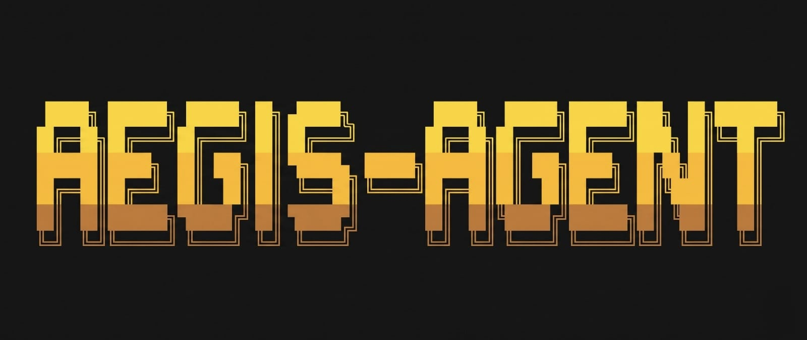

<p align="center">
  
</p>

# Aegis

### A practical home for defensive security agents and Hermes-style agent experiments

<p align="center">
  <a href="https://www.python.org/"></a>
  <a href="LICENSE"></a>
  <a href="#security-first-by-design"></a>
</p>

**Aegis is an experimental security workspace.** It includes a defensive SOC workbench for cases, assets, vulnerability findings, and analyst approvals, alongside standalone Hermes-inspired agent experiments. The components are learning prototypes, not a production security platform. Aegis is independent—not an official Nous Research product or a replacement for [Hermes Agent](https://github.com/NousResearch/hermes-agent).

</div>

---

## What’s here

| Project | Purpose | Start here |
| --- | --- | --- |
| [`hermes_starter/`](hermes_starter/) | Small model-driven assistant with a tool registry, allowlisted toolsets, opt-in Python plugins, SQLite session history, CLI, and offline tests. | [Starter guide](hermes_starter/README.md) |
| [`hermes_like/`](hermes_like/) | Minimal assistant scaffold with a command-line interface, OpenAI-compatible provider, local conversation history, and a tiny safe tool set. | [Scaffold guide](hermes_like/README.md) |
| [`soc_agent/`](soc_agent/) | Defense-first SOC workbench for cases, asset inventory, vulnerability findings, triage, and approval tracking. Integrations are placeholders and response actions are not executed. | [SOC workbench guide](soc_agent/README.md) |

These are prototypes with different goals, not one integrated production application. Choose one subproject and follow its own setup instructions.

## Hermes-style starter

The recommended starting point for experimenting with tool-driven agents is `hermes_starter/`:

- **Agent runtime** — handles a conversation and bounded tool-call loop.
- **Tool registry and toolsets** — explicitly register tools, then expose only selected tools to the model.
- **Opt-in plugins** — load a trusted module explicitly; plugins are ordinary Python code and are not sandboxed.
- **Local session history** — stores conversations in SQLite.
- **Offline tests** — exercise registry, toolsets, memory, and runtime using a fake provider.
- **Conservative built-ins** — calculator and UTC time; no shell, browser, or system-changing tools.

### Quick start

```bash
cd hermes_starter
python -m venv .venv

# Linux / macOS
source .venv/bin/activate

# Windows PowerShell
# .venv\Scripts\Activate.ps1

pip install -r requirements.txt
export OPENAI_API_KEY="your-key"
python -m agent.cli
```

To select an OpenAI-compatible endpoint, set `OPENAI_BASE_URL`. Set `HERMES_MODEL` to choose a model; the default is `gpt-4o-mini`.

To explicitly load the bundled example plugin:

```bash
python -m agent.cli --plugin plugins.example_plugin
```

**Only load plugins you trust.** Importing a plugin executes Python with the privileges of the current user.

Run the offline starter tests from `hermes_starter/`:

```bash
pip install pytest
python -m pytest -q
```

The tests use a fake provider; they do not need a model API key or make model calls.

## SOC workbench

The SOC workbench provides:

- A dashboard for alert cases, assets, vulnerability findings, and pending approvals.
- Case-linked SQLite records, finding lifecycle statuses, and audit events for approval decisions.
- A bearer-token-protected API with a server-configured role for requesting approvals.

### Quick start

From the repository root, create a virtual environment and install the dependencies:

```text
python -m venv .venv
# Windows PowerShell
.venv\Scripts\Activate.ps1
# macOS / Linux
# source .venv/bin/activate
python -m pip install -r requirements.txt
# Windows PowerShell
Copy-Item .env.example .env
# macOS / Linux
# cp .env.example .env
```

Edit `.env`: set a private `APP_API_TOKEN` and configure `OPENAI_API_KEY` (or `OPENAI_BASE_URL` for an OpenAI-compatible provider). Then start the API:

```powershell
python -m uvicorn soc_agent.app.main:app --host 127.0.0.1 --port 8000
```

Open [http://127.0.0.1:8000/dashboard](http://127.0.0.1:8000/dashboard) and enter the token. `APP_API_ROLE` defaults to `soc_analyst`; high-risk approval requests require the server-side role `incident_manager`. See [`soc_agent/README.md`](soc_agent/README.md) for API details and limitations.

This is a prototype, not a production SOC tool. The example SIEM, EDR, threat-intelligence, and identity adapters return simulated data. Approval decisions are recorded for review; the workbench does not scan targets or execute response actions. The shared bearer token and role are not multi-user authentication, so do not expose the dashboard publicly or use production credentials without independent security review.

## Security-first by design

Aegis prototypes are intended to explore safe agent patterns, not grant models authority. For any future integration:

1. Start with read-only credentials and narrow data scope.
2. Keep policy decisions deterministic and separate from model output.
3. Derive target scope from trusted case metadata—not model-generated arguments.
4. Require human approval for containment or other consequential changes.
5. Log tool proposals, guard decisions, results, approvals, and analyst overrides.
6. Evaluate attempted actions separately from actions permitted by the guard.
7. Do not treat prompt-injection detection heuristics as the security boundary.

## Repository layout

```text
.
├── hermes_starter/   # Tool-driven agent starter and offline tests
├── hermes_like/      # Minimal assistant scaffold
├── soc_agent/        # Defensive SOC workbench and triage prototype
└── tests/            # Tests for the root SOC prototype
```

## Development

Each subproject has its own dependencies and instructions. Run tests from the relevant project directory. This repository’s code and tests have not all been validated together as one integrated application; check the current test results before relying on any component.

## Upstream inspiration

This project is independently maintained and is not affiliated with Nous Research. For the full Hermes Agent framework, documentation, and current installation instructions, visit [NousResearch/hermes-agent](https://github.com/NousResearch/hermes-agent).

## License

This repository includes an MIT license. See [`LICENSE`](LICENSE) for terms. Hermes Agent remains a separate upstream project with its own license and maintainers.
